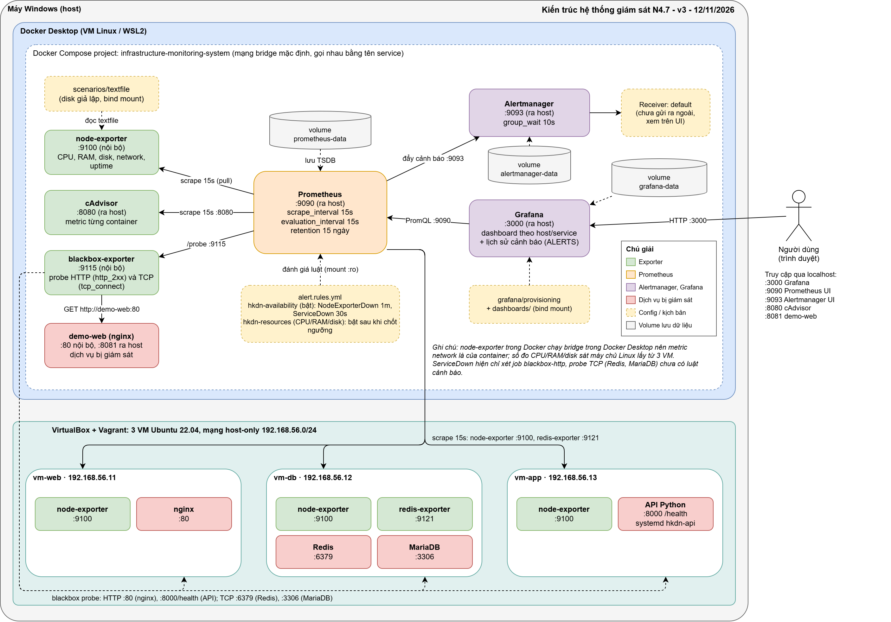

# Kiến trúc hệ thống giám sát (N4.7)

## Sơ đồ kiến trúc

File nguồn để chỉnh sửa: `docs/architecture.drawio` (mở bằng draw.io).

## Thành phần

| Thành phần | Vai trò | Cổng |
|---|---|---|
| Prometheus | Thu thập metric, lưu chuỗi thời gian, đánh giá luật cảnh báo | 9090 |
| Node Exporter | Metric của VM Docker Desktop (WSL2): CPU, RAM, disk, network, uptime | 9100 (nội bộ) |
| cAdvisor | Metric theo container | 8080 |
| Blackbox Exporter | Kiểm tra endpoint HTTP (UP/DOWN, thời gian phản hồi) | 9115 (nội bộ) |
| Alertmanager | Gom nhóm, giảm nhiễu, định tuyến cảnh báo | 9093 |
| Grafana | Dashboard theo host/service, xem lịch sử cảnh báo | 3000 |
| demo-web (nginx) | Dịch vụ mẫu bị giám sát | 8081 |

## Luồng dữ liệu

1. Exporter phơi bày metric; Prometheus scrape mỗi 15 giây.
2. Prometheus đánh giá `config/alert.rules.yml`; điều kiện đúng quá thời gian `for:` thì chuyển `pending` -> `firing` và gửi sang Alertmanager.
3. Alertmanager gom nhóm theo `alertname` và `instance` (`group_wait` 10s, `group_interval` 1m, `repeat_interval` 1h). Quy tắc ức chế: khi có cảnh báo `critical`, cảnh báo `warning` cùng `alertname` và `instance` bị bỏ qua. Cảnh báo được gửi tới receiver `default` (chưa gửi ra ngoài, xem trên UI :9093).
4. Grafana truy vấn Prometheus để hiển thị dashboard (`dashboards/host-service-overview.json`) và lịch sử cảnh báo qua metric `ALERTS`.

## Quy ước metric/nhãn

| Job | Nhãn gắn thêm | Ghi chú |
|---|---|---|
| `prometheus` | – | Prometheus tự giám sát chính nó |
| `node` | `host="lab-host-1"` | Metric VM Docker Desktop (WSL2) |
| `cadvisor` | – | Phân biệt container bằng nhãn `name` của cAdvisor |
| `blackbox-http` | `service="demo-web"`, `instance=<URL probe>` | Thêm dịch vụ: thêm URL vào targets, gắn nhãn `service` |

- `severity`: `warning` hoặc `critical`. Cảnh báo cùng loại ở hai mức dùng chung `alertname` để quy tắc ức chế hoạt động.
- Metric giả lập dùng tiền tố `hkdn_sim_` (xem `scenarios/02_disk_full.sh`).

## Giới hạn đã biết

- Node Exporter chạy trong Docker Desktop nên CPU, RAM, disk là của VM WSL2, không phải máy Windows; metric network là của container (chế độ bridge). Đo host Windows cần thêm windows_exporter (tùy chọn); trên Linux có thể dùng `network_mode: host`.
- Ngưỡng cảnh báo CPU, RAM, disk là bản đề xuất tạm theo baseline sơ bộ (xem mục Baseline), chờ thống nhất với UTH và mentor VNPT; việc áp ngưỡng vào `config/alert.rules.yml` do thành viên phụ trách cảnh báo thực hiện.
- Receiver mặc định chưa gửi ra ngoài (email/chat); cảnh báo chỉ xem trên giao diện Alertmanager và Grafana.
- Dữ liệu Prometheus lưu 15 ngày; lab là prototype một máy, không có HA.
- Chưa kết nối nền tảng quản trị trung tâm dữ liệu thật; chỉ dùng môi trường lab của nhóm, không dùng credential sản xuất.

## Kịch bản lỗi

Ba kịch bản lỗi và một kịch bản cảnh báo giả trong `scenarios/` dùng chung `lib.sh`: mỗi kịch bản gây lỗi, thăm dò Prometheus API (`/api/v1/query`, truy vấn `ALERTS`) mỗi 2 giây, ghi sự kiện vào `scenarios/results/events.log` (INJECT, DETECTED/NOT_DETECTED, RECOVER, RESOLVED, DONE), rồi khôi phục.

| Kịch bản | Cách gây lỗi | Cảnh báo kỳ vọng | Ghi chú |
|---|---|---|---|
| `01_cpu_high.sh` (mặc định 300s) | `docker run` container `hkdn-stress-cpu` (alpine) chạy vòng lặp chiếm toàn bộ CPU | `HighCpuUsage` | Số vòng lặp bằng số core của máy chạy script |
| `02_disk_full.sh` (mặc định 300s) | Chế độ `textfile`: ghi `hkdn_sim_disk_used_percent=92` vào `scenarios/textfile/sim_disk.prom`; chế độ `loop` (chỉ Linux, cần sudo): ổ ext4 200MB lấp ~92% | `DiskSpaceLowSimulated` (textfile), `DiskSpaceLow` (loop) | Docker Desktop tự chuyển sang `textfile`; không đụng ổ đĩa thật. `for:` của luật giả lập ngắn hơn thời gian chạy để kịp firing |
| `03_service_down.sh` (mặc định 120s) | `docker stop hkdn-demo-web` | `ServiceDown` | Blackbox probe báo `probe_success=0` |
| `01_cpu_high.sh 30` (cảnh báo giả) | Tăng CPU 30 giây, ngắn hơn `for:` của luật | `HighCpuUsage` chỉ ở trạng thái `pending`, không `firing` | Chứng minh tăng đột biến ngắn không gây cảnh báo giả |

Thời gian phát hiện (`detection_time`) đo từ lúc gây lỗi xong đến khi cảnh báo `firing` trên Prometheus, độ phân giải ~2s; chưa gồm `group_wait` của Alertmanager. Kết quả từng lần chạy ghi ở `scenarios/results.md`.

## Baseline và cơ sở đặt ngưỡng

Nguyên tắc: không đặt ngưỡng tùy ý trước khi đo. Baseline được đo bằng `tools/Baseline/baseline.py`, gọi Prometheus API (`/api/v1/query_range`, step 15s) với đúng biểu thức của dashboard `host-service-overview`. Kết quả đầy đủ ở `docs/baseline_result.md`.

Tái lập (chạy từ thư mục gốc repo, lab đã chạy ổn định và chưa bơm lỗi):

    python tools\Baseline\baseline.py --hours 4 --step 15 --out docs\baseline_result.md

**Phạm vi đo:** 4 giờ, từ 09:14 đến 13:14 UTC ngày 06/11/2026 (16:14 đến 20:14 giờ Việt Nam), 961 mẫu mỗi chuỗi, step 15s. Lab nhàn rỗi, không chạy kịch bản trong khoảng đo. Đây là **baseline sơ bộ**, chưa phủ chu kỳ ngày. Hai lần đo trước đó (5,3 giờ và 7,9 giờ dữ liệu) cho kết quả tương tự (CPU p50 0,245% và 0,230%, RAM 13 đến 15%), cho thấy baseline lặp lại ổn định.

| Chỉ số | avg | p50 | p99 | max | Nhận xét |
|---|---|---|---|---|---|
| CPU (%) | 0,270 | 0,254 | 0,395 | 5,736 | Lab gần như rảnh, chỉ có đỉnh ngắn 5,7% |
| RAM (%) | 14,261 | 14,225 | 15,068 | 15,311 | Dao động hẹp (~13 đến 15%) |
| Disk `/var/lib` (%) | 7,577 | 7,577 | 7,579 | 7,579 | Gần như không đổi nên phân vị không có ý nghĩa |
| Network nhận (B/s) | 41,6 | 41,6 | 41,6 | 42,5 | Lưu lượng gần bằng 0, là của VM Docker Desktop |
| Network gửi (B/s) | 1013,8 | 1013,4 | 1017,4 | 1018,2 | Như trên |
| Thời gian probe demo-web (s) | 0,002 | 0,002 | 0,003 | 0,004 | Probe thành công 100% (UP) |

**Ngưỡng đề xuất (bản nháp, chờ thống nhất với UTH và mentor VNPT):**

| Chỉ số | Warning | Critical | `for:` | Cơ sở |
|---|---|---|---|---|
| CPU | 70% | 90% | 2m | Baseline rất thấp nên có khoảng dư lớn, ngưỡng theo mức vận hành thông thường. `for:` cân bằng giữa phát hiện nhanh và cảnh báo giả (kết quả NAB cho thấy `for:` dài làm mất đỉnh ngắn), kiểm chứng bằng kịch bản cảnh báo giả (CPU 30 giây không được `firing`) |
| RAM | 80% | 90% | 5m | Baseline p99 15,1%, dư gấp nhiều lần |
| Disk | 80% | 90% | 5m | Giá trị gần như không đổi nên dùng ngưỡng tuyệt đối; chỉ xét mountpoint `/var/lib` (và `/mnt/hkdn-small-disk` cho chế độ `loop`), nhóm cần xác nhận |
| Disk giả lập | 80% | | 1m | Kịch bản ghi giá trị 92; `for:` 1 phút để kịp `firing` trong 300 giây chạy |
| ServiceDown | `probe_success == 0` | | 30s | Probe UP 100% trong thời gian đo |
| NodeExporterDown | `up == 0` | | 1m | Luật sống/chết, không cần ngưỡng |
| Network | không đặt ngưỡng | | | Lưu lượng gần bằng 0, chưa có cơ sở |

Baseline cho biết khoảng dư rất lớn nên không suy ra trực tiếp được mức ngưỡng. Ngưỡng 70/80/90 là mức vận hành thông thường (tham khảo các tài liệu ở mục Tài liệu tham khảo), sẽ được kiểm chứng bằng kịch bản và chỉnh sau khi thống nhất với UTH và mentor VNPT.

**Lưu ý khi đọc baseline:**
- Node Exporter chạy trong Docker Desktop (WSL2) nên số đo là của VM, không phải máy Windows.
- Bảng disk trong `docs/baseline_result.md` có nhiều dòng trùng do Docker Desktop mount cùng một ổ nhiều lần (`/mnt/host/...`, `/parent-distro/...`, `/run/desktop/...`). Luật disk cần giới hạn theo mountpoint cụ thể (nhóm sẽ chốt), để tránh cảnh báo trùng. Ổ C (~63,1%) và ổ D (~78,8%) là ổ của máy Windows, nằm ngoài phạm vi giám sát của lab; ổ D sát ngưỡng warning 80% nên không được đưa vào luật.
- Các bảng CPU/RAM theo container đang không có dữ liệu: cAdvisor trên Docker Desktop báo lỗi đọc lớp image của container, đang xử lý.

## Kiểm chứng phương pháp đặt ngưỡng bằng NAB

Dùng Numenta Anomaly Benchmark (NAB, nguồn dữ liệu do VNPT đề xuất) để so sánh các cách đặt ngưỡng và `for:` trên chuỗi CPU có nhãn bất thường. Dữ liệu và nhãn lấy từ repo NAB (`data/`, `labels/combined_windows.json`); phương pháp đánh giá là của nhóm. Script: `tools/nab_threshold_eval.py`, kết quả: `docs/nab_result.md`. Cách làm: lấy các phân vị p90, p95, p99, p99.9 và max của đoạn bình thường làm ngưỡng ứng viên; đếm số cửa sổ bất thường bắt được và số đợt cảnh báo giả (đợt vượt ngưỡng bắt đầu ngoài cửa sổ bất thường). Tùy chọn yêu cầu vượt liên tục N điểm để mô phỏng `for:`.

Tái lập (NAB clone ngoài repo):

    git clone --depth 1 https://github.com/numenta/NAB.git D:\nab\NAB
    python tools\nab_threshold_eval.py --nab D:\nab\NAB realAWSCloudwatch/ec2_cpu_utilization_5f5533.csv realAWSCloudwatch/ec2_cpu_utilization_825cc2.csv

Kết quả chính (mỗi chuỗi 4032 điểm):

| Chuỗi | Ngưỡng | Giá trị | N=1: bắt / giả | N=3: bắt / giả |
|---|---|---|---|---|
| 5f5533 (nền ~43%, 2 cửa sổ) | p90 | 49,1 | 2/2 / 357 | 1/2 / 0 |
| | p99 | 53,3 | 2/2 / 37 | 0/2 / 0 |
| | p99.9 | 54,9 | 2/2 / 4 | 0/2 / 0 |
| | max | 56,4 | 2/2 / 0 | 0/2 / 0 |
| 825cc2 (nền ~92%, 1 cửa sổ) | p90 | 95,6 | 1/1 / 259 | 0/1 / 23 |
| | p99 | 97,2 | 1/1 / 33 | 0/1 / 0 |
| | p99.9 | 98,2 | 1/1 / 4 | 0/1 / 0 |
| | max | 99,1 | 0/1 / 0 | 0/1 / 0 |

Rút ra:
- Ngưỡng thấp (p90, p95) cho hàng trăm đợt cảnh báo giả. Ngưỡng cao hơn giảm cảnh báo giả nhưng ngưỡng quá sát đỉnh (max ở `825cc2`) bỏ sót cửa sổ bất thường.
- Yêu cầu vượt liên tục 3 điểm (~15 phút) giảm mạnh cảnh báo giả (về 0 ở hầu hết các ngưỡng) nhưng hầu như không bắt được cửa sổ nào (tối đa 1/2 ở p90 của `5f5533`), vì bất thường trong NAB chủ yếu là đỉnh ngắn. `for:` dài giảm cảnh báo giả nhưng làm chậm hoặc mất phát hiện, cần cân bằng.
- Hai chuỗi có mức nền rất khác nhau (43% và 92%), nên ngưỡng phải dựa trên baseline của từng hệ thống.

Lưu ý khi dùng kết quả:
- NAB chỉ dùng để kiểm chứng phương pháp, không dùng số của NAB làm ngưỡng cho lab. Ngưỡng của lab lấy từ baseline Prometheus ở trên.
- NAB lấy mẫu 5 phút/điểm, lab 15 giây/điểm, nên "N điểm" của NAB không tương đương `for:` của luật.
- Cửa sổ bất thường của NAB khá rộng, "bắt được cửa sổ" là thước đo tương đối dễ. Chỉ dùng để so sánh các ngưỡng với nhau, không coi là độ chính xác tuyệt đối.
- Ngưỡng ứng viên được tính trên chính chuỗi dùng để đánh giá (không tách tập huấn luyện và kiểm thử), nên kết quả hơi lạc quan.

## Hạn chế và bước tiếp theo

**Hạn chế:**
- Baseline sơ bộ trên 4 giờ dữ liệu (961 mẫu mỗi chuỗi), chưa phủ chu kỳ ngày.
- Lab gần như không có tải, nên baseline chỉ cho biết khoảng dư lớn, chưa phản ánh tải thực của máy chủ.
- Số đo là của VM Docker Desktop (WSL2), không phải máy Windows hay máy chủ thật.
- Metric theo container (cAdvisor) chưa có dữ liệu trên Docker Desktop nên panel CPU/RAM theo container đang trống.
- Ngưỡng tĩnh bắt không tốt các đỉnh ngắn (theo kết quả NAB).
- Receiver Alertmanager chưa gửi ra ngoài (email/chat), chưa kết nối nền tảng quản trị trung tâm dữ liệu thật.
- Prototype một máy, không có HA, dữ liệu Prometheus lưu 15 ngày.

**Bước tiếp theo:**
- Đo lại baseline khi lab chạy đủ 24 giờ, loại đoạn chạy kịch bản, chốt ngưỡng cùng UTH và mentor VNPT.
- Chạy mỗi kịch bản 3 lần, ghi thời gian phát hiện và minh chứng vào `scenarios/results.md`.
- Chốt mountpoint disk cho luật và dashboard, sửa panel container (cAdvisor).
- Cân nhắc ngưỡng động (theo trung bình trượt, độ lệch chuẩn) hoặc dự báo bằng Python cho CPU, disk.
- Bổ sung kênh gửi cảnh báo (email/chat) và cảnh báo độ trễ probe nếu cần.
- Thử thêm dữ liệu public khác (Google Cluster Data) để kiểm chứng ngưỡng.

## Tài liệu tham khảo

- Ahmad, S., Lavin, A., Purdy, S., Agha, Z. (2017). "Unsupervised real-time anomaly detection for streaming data". Neurocomputing. Dữ liệu: https://github.com/numenta/NAB
- Prometheus, hướng dẫn viết cảnh báo (Alerting best practices): https://prometheus.io/docs/practices/alerting/
- Google SRE Book, chương "Monitoring Distributed Systems": https://sre.google/sre-book/monitoring-distributed-systems/
