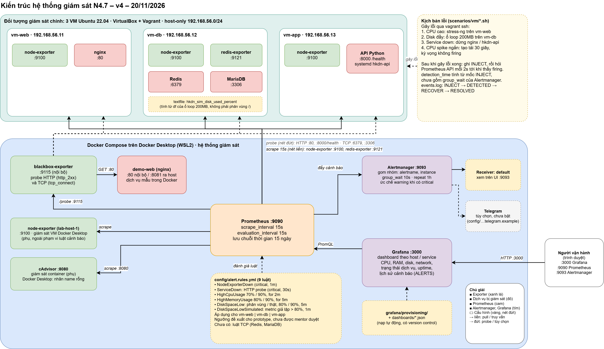

# Kiến trúc hệ thống giám sát (N4.7)

## Sơ đồ kiến trúc



File nguồn để chỉnh sửa: `docs/architecture.drawio` (mở bằng draw.io).

Kiến trúc có hai vùng triển khai:

1. **VirtualBox + Vagrant:** ba VM Ubuntu 22.04 trong mạng host-only `192.168.56.0/24`, là nhóm máy chủ Linux chính được giám sát.
2. **Docker Compose trên Docker Desktop (WSL2):** chạy Prometheus, Grafana, Alertmanager, Blackbox Exporter và các exporter phụ trợ.

Prometheus scrape Node Exporter trên cả ba VM qua mạng host-only. Blackbox Exporter probe HTTP tới Nginx/API và TCP tới Redis/MariaDB. Node Exporter `lab-host-1` cùng cAdvisor là các target phụ trợ của môi trường Docker Desktop/container; không nên nhầm chúng với ba VM Linux chính.

## 1. Máy chủ và dịch vụ được giám sát

| VM | IP host-only | Dịch vụ | Exporter / kiểm tra |
|---|---|---|---|
| `vm-web` | `192.168.56.11` | Nginx :80 | Node Exporter :9100; HTTP probe |
| `vm-db` | `192.168.56.12` | Redis :6379; MariaDB :3306 | Node Exporter :9100; Redis Exporter :9121; TCP probe :6379 và :3306 |
| `vm-app` | `192.168.56.13` | Python API :8000, endpoint `/health`, systemd `hkdn-api` | Node Exporter :9100; HTTP probe |

Mỗi VM được cấp 1 CPU và 1 GB RAM theo cấu hình lab hiện tại. Chi tiết provisioning và lệnh vận hành: `docs/vm-environment.md`.

## 2. Thành phần monitoring stack

| Thành phần | Vai trò | Cổng |
|---|---|---|
| Prometheus | Thu thập metric, lưu chuỗi thời gian, đánh giá luật cảnh báo | 9090 |
| Node Exporter (Docker) | Metric của môi trường Docker Desktop/WSL2, nhãn `host="lab-host-1"` | 9100 nội bộ |
| Node Exporter (3 VM) | CPU, RAM, filesystem, network, uptime của từng VM | 9100 trên mỗi VM |
| Redis Exporter | Metric Redis trên `vm-db` | 9121 |
| cAdvisor | Metric theo container Docker | 8080 |
| Blackbox Exporter | Probe endpoint HTTP và cổng TCP | 9115 nội bộ |
| Alertmanager | Gom nhóm, giảm nhiễu, định tuyến cảnh báo | 9093 |
| Grafana | Dashboard theo host/service và trạng thái cảnh báo | 3000 |
| demo-web (nginx) | Dịch vụ mẫu trong Docker, dùng cho kiểm thử phụ trợ | 8081 ra host |

Node Exporter `lab-host-1` và cAdvisor chỉ nên được xem là phần giám sát bổ sung cho Docker Desktop. Đối tượng máy chủ chính trong phạm vi đề tài hiện là `vm-web`, `vm-db`, `vm-app`.

## 3. Luồng dữ liệu

1. Exporter phơi bày metric. Prometheus scrape mỗi 15 giây, gồm Node Exporter trên ba VM, Redis Exporter và các exporter phụ trợ trong Docker.
2. Blackbox Exporter thực hiện HTTP probe tới demo-web, Nginx, API; TCP probe tới Redis và MariaDB. Prometheus thu thập kết quả `probe_success` và thời gian probe.
3. Prometheus đánh giá `config/alert.rules.yml`; khi điều kiện đúng liên tục đủ thời gian `for:`, alert chuyển `pending` → `firing` và được gửi sang Alertmanager.
4. Alertmanager gom nhóm theo `alertname` và `instance` (`group_wait` 10s, `group_interval` 1m, `repeat_interval` 1h). Khi có cảnh báo `critical`, cảnh báo `warning` cùng `alertname` và `instance` bị inhibit.
5. Alertmanager hiện dùng receiver `default`; chưa cấu hình gửi email/chat ra ngoài. Cảnh báo có thể xem trên UI `http://localhost:9093`.
6. Grafana truy vấn Prometheus để hiển thị dashboard `dashboards/host-service-overview.json` và trạng thái alert qua metric `ALERTS`.

## 4. Quy ước metric và nhãn

| Job | Nhãn | Ghi chú |
|---|---|---|
| `prometheus` | – | Prometheus tự giám sát |
| `node` | `host="lab-host-1"` | Node Exporter phụ trợ trong Docker Desktop |
| `node` | `host="vm-web"`, `vm-db`, `vm-app` | Node Exporter của ba VM; dùng chung job `node` |
| `redis` | `host="vm-db"`, `service="redis"` | Redis Exporter :9121 |
| `cadvisor` | – | Metric container; nhãn container do cAdvisor cung cấp |
| `blackbox-http` | `service="demo-web"` / `nginx` / `api`; `host` với VM; `instance` là URL probe | Probe HTTP |
| `blackbox-tcp` | `service="redis"` / `mariadb`, `host="vm-db"` | Probe TCP cổng 6379 và 3306 |

`severity` dùng `warning` hoặc `critical`. Các mức cảnh báo của cùng một loại dùng chung `alertname` để hỗ trợ inhibit. Metric disk giả lập có tên `hkdn_sim_disk_used_percent`, được xuất qua Node Exporter Textfile Collector trên `vm-db`.

## 5. Các luật cảnh báo đang cấu hình

Cấu hình hiện tại có **9 rule** trong `config/alert.rules.yml`:

| Alert | Điều kiện | `for:` | Phạm vi |
|---|---|---:|---|
| `NodeExporterDown` | `up{job="node",host=~"vm-web\|vm-db\|vm-app"} == 0` | 1m | Node Exporter của 3 VM |
| `ServiceDown` | `probe_success{job="blackbox-http"} == 0` | 30s | HTTP probe |
| `HighCpuUsage` – warning | CPU > 70% | 2m | 3 VM |
| `HighCpuUsage` – critical | CPU > 90% | 2m | 3 VM |
| `HighMemoryUsage` – warning | RAM > 80% | 5m | 3 VM |
| `HighMemoryUsage` – critical | RAM > 90% | 5m | 3 VM |
| `DiskSpaceLow` – warning | Disk root `/` > 80%, ext4 | 5m | 3 VM |
| `DiskSpaceLow` – critical | Disk root `/` > 90%, ext4 | 5m | 3 VM |
| `DiskSpaceLowSimulated` | `hkdn_sim_disk_used_percent > 80` | 1m | Metric giả lập trên `vm-db` |

Các ngưỡng CPU 70/90%, RAM 80/90% và Disk 80/90% là ngưỡng đề xuất đang dùng trong prototype, chưa phải ngưỡng production hoặc ngưỡng đã được mentor phê duyệt. Baseline thấp không tự nó chứng minh các ngưỡng này là tối ưu; cần tiếp tục kiểm thử và xin xác nhận.

**Phạm vi cảnh báo dịch vụ:** `ServiceDown` hiện chỉ xét `job="blackbox-http"`. Redis/MariaDB có TCP probe trong Prometheus nhưng hiện chưa được luật `ServiceDown` bao phủ. `NodeExporterDown` hiện lọc ba VM, không áp dụng cho target `lab-host-1`.

## 6. Kịch bản lỗi

Các kịch bản VM nằm trong `scenarios/vm/`; kịch bản Docker nằm trong `scenarios/`.

| Kịch bản VM | Cách gây lỗi | Alert kỳ vọng | Lưu ý |
|---|---|---|---|
| CPU High | Chạy `stress-ng` trên `vm-web` | `HighCpuUsage` | Script xác nhận stress-ng chạy rồi mới bắt đầu tính detection time |
| Disk Full giả lập | Tạo filesystem loop 200 MB trên `vm-db`, ghi dữ liệu khoảng 92%, xuất `hkdn_sim_disk_used_percent` qua Textfile Collector | `DiskSpaceLowSimulated` | Không làm đầy root filesystem; không phải kiểm thử thành công `DiskSpaceLow` |
| Service Down | Dừng Nginx trên `vm-web` hoặc `hkdn-api` trên `vm-app` | `ServiceDown` | HTTP probe thất bại |
| CPU spike ngắn | Chạy tải CPU 30 giây | Không được chuyển `HighCpuUsage` sang `firing` | Điều kiện ngắn hơn `for: 2m` |

### Phương pháp đo detection/resolve time

Các script VM đặt mốc `START` sau khi thao tác gây lỗi đã hoàn tất và được xác nhận:
- CPU: sau khi `stress-ng` được khởi chạy và script xác nhận service đang active.
- Service Down: sau khi lệnh dừng dịch vụ hoàn tất.
- Disk Full: sau khi tạo filesystem, ghi dữ liệu và xác nhận metric Textfile Collector đã được Node Exporter đọc.

Ngay sau mốc `START`, script ghi `INJECT` rồi gọi `wait_for_alert`, truy vấn Prometheus API mỗi 2 giây. **Detection time** là thời gian từ mốc `START` này đến lần polling đầu tiên thấy alert `firing`. Vì vậy, không mô tả detection time là thời gian từ lúc bắt đầu chạy script hoặc từ lúc bắt đầu thao tác gây lỗi.

Sau khi thao tác khôi phục hoàn tất, script ghi `RECOVER` rồi bắt đầu `wait_for_resolved`. **Resolve time** là thời gian từ lúc bắt đầu chờ sau `RECOVER` đến lần polling đầu tiên xác nhận alert không còn `firing`. Đây là thời gian đo bằng polling, độ phân giải xấp xỉ 2 giây; không bao gồm thời gian Alertmanager gửi thông báo tới receiver.

Kết quả từng lần chạy được tổng hợp tại `scenarios/results.md`; log chi tiết ở `scenarios/results/events.log`.

## 7. Baseline Linux VM và cơ sở đặt ngưỡng

Baseline hiện tại được thu thập trên ba Linux VM, không phải baseline cũ của Docker Desktop/WSL2.

- Khoảng đo: **2026-11-18 21:06 UTC → 2026-11-19 15:06 UTC** (18 giờ).
- Step: **60 giây**.
- Số mẫu: **1081 mẫu/chuỗi/host**.
- Phạm vi: `vm-web`, `vm-db`, `vm-app`.
- Disk: chỉ filesystem root `/`, ext4; loại bỏ shared folder `/vagrant`.
- Điều kiện: vận hành bình thường, không bơm lỗi.
- Báo cáo đầy đủ: `docs/baseline_result.md`.

### CPU (%)

| Host | avg | p50 | p95 | p99 | max |
|---|---:|---:|---:|---:|---:|
| vm-app | 3.483 | 3.164 | 4.073 | 6.064 | 13.744 |
| vm-db | 3.756 | 3.424 | 4.351 | 6.415 | 12.764 |
| vm-web | 3.639 | 3.304 | 4.220 | 6.326 | 13.712 |

### RAM (%)

| Host | avg | p50 | p95 | p99 | max |
|---|---:|---:|---:|---:|---:|
| vm-app | 36.661 | 36.949 | 37.300 | 37.318 | 37.343 |
| vm-db | 43.365 | 43.592 | 43.888 | 43.910 | 43.935 |
| vm-web | 36.112 | 36.333 | 36.783 | 36.805 | 36.847 |

### Disk root `/` (%)

| Host | avg | p50 | p95 | p99 | max |
|---|---:|---:|---:|---:|---:|
| vm-app | 4.955 | 4.964 | 4.966 | 4.966 | 4.966 |
| vm-db | 5.743 | 5.736 | 5.754 | 5.758 | 5.758 |
| vm-web | 4.934 | 4.933 | 4.935 | 4.935 | 5.297 |

### Network và HTTP probe

- Network nhận trung bình: vm-app 599.730 B/s; vm-db 484.666 B/s; vm-web 434.627 B/s. Có spike ngắn nên max cao hơn nhiều so với p95.
- Network gửi trung bình: vm-app 1161.256 B/s; vm-db 1457.973 B/s; vm-web 1168.284 B/s.
- HTTP probe duration trung bình khoảng 0.004 giây cho cả API và Nginx; max 0.009 giây.
- HTTP probe success: 100% (1081/1081 mẫu cho mỗi dịch vụ trong khoảng đo).

### Ngưỡng đề xuất hiện áp dụng

| Chỉ số | Warning | Critical | `for:` | Ghi chú |
|---|---:|---:|---:|---|
| CPU | 70% | 90% | 2m | Ngưỡng đề xuất; kiểm thử CPU 30 giây không được firing |
| RAM | 80% | 90% | 5m | Ngưỡng đề xuất |
| Disk root | 80% | 90% | 5m | Chỉ mountpoint `/`, fstype ext4 |
| Disk giả lập | >80% | – | 1m | Dùng metric mô phỏng để demo |
| ServiceDown | probe_success = 0 | – | 30s | Chỉ HTTP |
| NodeExporterDown | up = 0 | – | 1m | Chỉ ba VM |

Baseline 18 giờ cho thấy tài nguyên ở trạng thái lab tương đối ổn định, nhưng chưa đại diện cho chu kỳ dài hạn. Step 60 giây có thể bỏ qua biến động ngắn. Các ngưỡng trên không được tính trực tiếp từ p95/p99; đây là ngưỡng đề xuất để thử nghiệm và cần mentor xác nhận.

Tái lập baseline (chạy từ thư mục gốc repo, Prometheus đang hoạt động):

```bash
python tools/Baseline/baseline.py --prom http://localhost:9090 --hours 18 --step 60 --out docs/baseline_result.md
```

## 8. Kiểm chứng phương pháp đặt ngưỡng bằng NAB

Dùng Numenta Anomaly Benchmark (NAB) để so sánh các cách đặt ngưỡng và `for:` trên chuỗi CPU có nhãn bất thường. Dữ liệu và nhãn lấy từ repo NAB (`data/`, `labels/combined_windows.json`); phương pháp đánh giá là của nhóm. Script: `tools/nab_threshold_eval.py`, kết quả: `docs/nab_result.md`.

Kết quả chính (mỗi chuỗi 4032 điểm):

| Chuỗi | Ngưỡng | Giá trị | N=1: bắt / giả | N=3: bắt / giả |
|---|---|---:|---:|---:|
| 5f5533 (nền ~43%, 2 cửa sổ) | p90 | 49.1 | 2/2 / 357 | 1/2 / 0 |
|  | p99 | 53.3 | 2/2 / 37 | 0/2 / 0 |
|  | p99.9 | 54.9 | 2/2 / 4 | 0/2 / 0 |
|  | max | 56.4 | 2/2 / 0 | 0/2 / 0 |
| 825cc2 (nền ~92%, 1 cửa sổ) | p90 | 95.6 | 1/1 / 259 | 0/1 / 23 |
|  | p99 | 97.2 | 1/1 / 33 | 0/1 / 0 |
|  | p99.9 | 98.2 | 1/1 / 4 | 0/1 / 0 |
|  | max | 99.1 | 0/1 / 0 | 0/1 / 0 |

NAB chỉ dùng để kiểm chứng phương pháp, không dùng số của NAB làm ngưỡng cho lab. NAB lấy mẫu 5 phút/điểm, lab 15 giây/điểm; số điểm liên tục không tương đương trực tiếp với thời gian `for:` trong lab. Ngưỡng ứng viên được tính trên chính chuỗi dùng để đánh giá nên kết quả có thể lạc quan.

## 9. Giới hạn và bước tiếp theo

- Baseline mới có 18 giờ, chưa phủ đủ ngày thường/cuối tuần hoặc tải dài hạn.
- Step 60 giây có thể bỏ qua biến động ngắn.
- Lab chạy trên một host, chưa có HA.
- cAdvisor trên Docker Desktop có thể không cung cấp đầy đủ metric container; cần xem đây là phần phụ trợ.
- `DiskSpaceLowSimulated` không thay thế kiểm thử `DiskSpaceLow` trên root filesystem thật.
- `ServiceDown` hiện chỉ xét HTTP, chưa cảnh báo TCP Redis/MariaDB.
- Alertmanager chưa gửi email/chat ra ngoài.
- Chưa kết nối hệ thống NOC/DCIM thật và không sử dụng credential production.

## 10. Tài liệu tham khảo

- Ahmad, S., Lavin, A., Purdy, S., Agha, Z. (2017). “Unsupervised real-time anomaly detection for streaming data”. Dữ liệu: https://github.com/numenta/NAB
- Prometheus, Alerting best practices: https://prometheus.io/docs/practices/alerting/
- Google SRE Book, “Monitoring Distributed Systems”: https://sre.google/sre-book/monitoring-distributed-systems/
